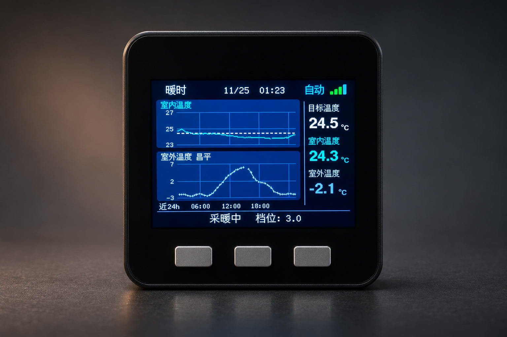
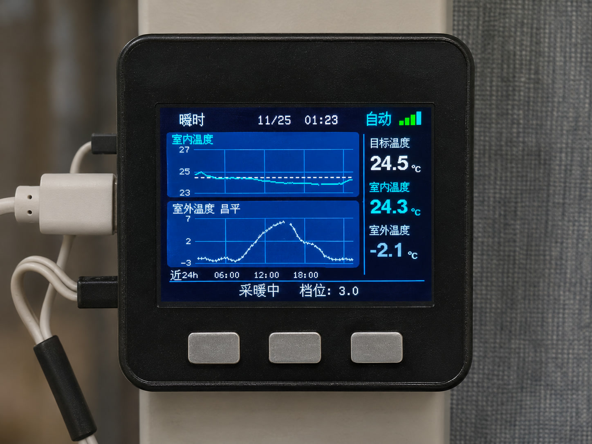
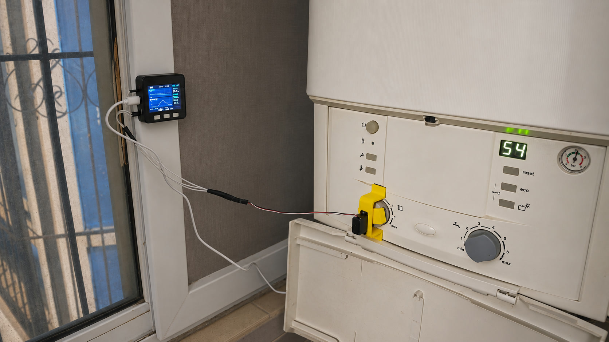

# 暖时 NuanShi

基于 M5Stack Basic（经典 ESP32，4 MiB 闪存）的地暖温控项目。设备通过 BLE 读取米家温度计，在屏幕和局域网网页上显示温度趋势，并根据采暖时段、室温和策略调整舵机档位。

<p align="center">
  
  <br><sub>根据当前屏幕界面制作的效果图</sub>
</p>

## 功能

- 支持米家 `LYWSD03MMC`，采样间隔可设为 1–20 分钟。主温度计多次读取失败时可依次尝试两只备用温度计。
- 以室内温度和趋势为依据调档，提供观测、手动和自动模式。自动模式启用前须完成舵机标定。
- 显示室内外温度曲线、目标温度和档位，在 microSD 卡上保存系统日志和温度历史。室外数据来自 Open-Meteo，默认地点为北京昌平。
- 在局域网网页修改设置、下载日志、更换 [JSON 控制策略](Firmware/strategies/README.md)，或上传完整固件。

<p align="center">
  
  <br><sub>屏幕近照，经 AI 修整</sub>
</p>

## 硬件

| 项目 | 说明 |
| --- | --- |
| 主控 | M5Stack Basic，经典 ESP32，4 MiB 闪存，320 × 240 屏幕 |
| 室温传感器 | 小米米家 `LYWSD03MMC`，M5Stack 按已配置的 BLE 地址读取 |
| 存储 | FAT32 microSD 卡，保存 Wi‑Fi 和米家温度计配置、日志及温度历史 |
| 舵机信号 | GPIO17（M-Bus 第 16 脚），PWM 50 Hz |

<p align="center">
  
  <br><sub>实物安装全景，经 AI 修整</sub>
</p>

## 编译与配置

1. 安装 [PlatformIO Core](https://docs.platformio.org/en/latest/core/installation/index.html)。
2. 如需网页访问，编译前创建本地文件 `Firmware/src/local_config.h`，填入自己选择的密码对应的 **64 个小写十六进制字符的 SHA-256 摘要**。例如，可以用 Python 的 `getpass.getpass()` 读取密码，再用 `hashlib.sha256(password.encode()).hexdigest()` 生成摘要。该文件已加入 Git 忽略规则。
3. 在仓库根目录执行 `pio run -d Firmware`，产物为 `Firmware/.pio/build/m5stack-basic-bench/firmware.bin`。首次部署或迁移双分区时，通过 USB 执行 `pio run -d Firmware -t upload`。
4. 设备连网后在「关于」查看 Wi‑Fi IP，用同一局域网的浏览器访问该地址并登录。

`local_config.h` 的格式如下。未配置网页登录密码摘要时，设备关闭网页服务，屏幕和采样功能仍可使用。

```cpp
#pragma once
#define NUANSHI_WEB_PASSWORD_SHA256 "" // 填入自己生成的摘要
```

### Wi‑Fi 和米家温度计

复制 [配置模板](Firmware/nuanshi-device.example.json)，改名为 `nuanshi-device.json` 并放到 microSD 卡根目录。用 UTF-8（无 BOM）保存，修改后重启设备。

- `wifi.ssid` 和 `wifi.password` 填 Wi‑Fi 名称和密码。名称最多 32 字节，密码最多 64 字节，开放网络将密码留空。
- `mijia.primary` 填主温度计的蓝牙 MAC，格式为 `XX:XX:XX:XX:XX:XX`。`backup_near` 和 `backup_far` 可留空。每轮先尝试主温度计最多三次，仍失败时依次尝试近、远备用温度计各一次。空白、格式错误和重复的备用地址会被跳过。
- 固件按 MAC 直连 `LYWSD03MMC`，尝试读取 BLE GATT 测量特征，必要时等该特征的通知。配置只需要蓝牙 MAC。
- 有效的 JSON Wi‑Fi 配置和主温度计地址优先。对应字段缺失或格式无效时，设备分别读取旧的 `nuanshi-wifi.bin` 和 `nuanshi-mijia.bin`。沿用原卡时，可以省略整个 `wifi` 段和 `mijia.primary`，只填备用地址。

Wi‑Fi 密码以明文保存在 SD 卡上。实际配置文件已加入 Git 忽略规则，仓库中只提供示例。Wi‑Fi 信息和温度计地址由固件在启动时读取，更换配置无需重编译。

## 按键与更新

- 长按 B 进入或退出设置。松手后再长按方可执行下一个动作。
- 观测或自动模式下，短按 A 查看策略。规则页用 A 返回、B 上一页、C 下一页。
- 手动模式下，A 减档，C 加档，B 短按无动作。
- 安装了双分区固件后，从网页的「更新固件」上传应用镜像 `firmware.bin`。上传到 100% 后等设备完成校验和重启。局域网页使用 HTTP，请在可信局域网内使用。

## 许可证

项目代码采用 [MIT 许可证](LICENSE)。随固件分发的 efont 字形保留其 [原许可证](Firmware/licenses/efont.txt)。PlatformIO 依赖由各自许可证授权。
